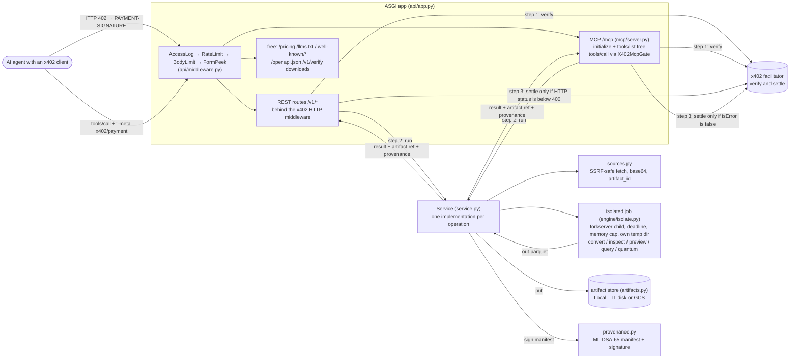

# Architecture

One ASGI process serves three things: the REST API (FastAPI), a remote MCP server
(Streamable HTTP at `/mcp`), and free discovery documents. REST and MCP are two front doors to
the same `Service`. Every operation has exactly one implementation, so both doors always agree
on what counts as success, and success is what triggers settlement.

## Request path

1. **Edge middleware** (pure ASGI, outermost first). `AccessLogMiddleware` assigns a request
   ID and logs whether a payment settled. `RateLimitMiddleware` runs a token bucket per client
   IP. `BodyLimitMiddleware` enforces 16 MB for JSON and MCP requests and the input cap for
   multipart uploads, while the body streams. `FormPeekMiddleware` reads up to 1 MiB of an
   upload form, so its `options` can be checked before the quote, then replays it unchanged.
2. **Payment gate.** A request that can only fail is refused before any quote: an invalid
   REST body or form is a 400 (`_body_check`, `_form_check` in `api/app.py`), invalid MCP tool
   arguments an `isError` result (`argument_checker`), and a tool this deployment does not
   serve is a free "Unknown tool". An empty unpaid body stays a price probe.
   - REST: the x402 SDK's FastAPI middleware sits in front of the paid `/v1/*` routes only. We
     wrap it so the facilitator is initialized lazily on the first paid request (see
     [payments.md](payments.md)).
   - MCP: the x402 HTTP middleware is deliberately **not** in front of `/mcp`, because
     `initialize` and `tools/list` must stay free for discovery. `payments/mcp_gate.py`
     charges per `tools/call` instead.
3. **`Service`** (`service.py`). Each operation first takes a job slot (`_job()`); a full
   queue answers 503 `busy`, and nothing is charged. Holding the slot, it materializes the
   input into a private work directory: exactly one of `url`, `content_base64`, `artifact_id`
   or an upload (copied in by `convert_upload`), plus `path` in local mode only. All URL and
   base64 inputs of one call share one `max_input_bytes` budget, and the stored artifacts the
   call reads are held (`store.hold()`) so nothing evicts them while it runs.
4. **Isolated job.** Every engine call (convert, inspect, preview, query and the quantum
   tools; with the default `AIMART_ISOLATE_JOBS=true`) runs in a child forked from a `forkserver` that has already imported the engine, so
   a job costs a fork, not a fresh interpreter. The parent kills the child at its deadline
   (504 `timeout`) or when its resident memory passes `AIMART_JOB_MEMORY_LIMIT_MB` (700 MB by
   default; 413 `input_too_large`), and deletes the job's own temporary directory either way.
   A crash becomes `InvalidInput`; any other unexpected exception is logged and reported by
   its type only. All of these are unpaid. The cap is an RSS watchdog, not `RLIMIT_AS`: a
   Linux child starts at about 2 GB of virtual memory. Its cost: a CSV converts at about 3.5
   times its decompressed size, so on the default 2 GiB instance CSVs above roughly 180-200 MB
   are refused. See [ADR 0005](adr/0005-job-isolation-forkserver.md).
5. **Engine** (`engine/`). Detection by magic bytes (`detect.py`) is followed by bomb-safe
   decompression (`safety.py`) and UTF-8 transcoding (`text.py`). A reader (`readers/`)
   produces a raw table in a locked-down DuckDB connection (`duck.py`). Next come type
   inference in SQL (`infer.py`), name normalization (`names.py`), and the writer
   (`writer.py`): DuckDB `COPY` to zstd Parquet, or pyarrow when labels must be embedded
   ([ADR 0006](adr/0006-duckdb-copy-writer.md)).
6. **Artifact store.** The output goes to `LocalArtifactStore` (TTL disk, HMAC-signed links)
   or `GcsArtifactStore` (V4 signed URLs). The caller gets a reference (`artifact_id` and
   `download_url`), not the bytes ([ADR 0007](adr/0007-artifact-references-not-bytes.md)).
   Room is made before an output is stored, never by evicting an unsettled output, a local
   one delivered in the last 10 minutes, or one a running call reads: an output that cannot
   fit is refused (413 over the whole budget, 503 `busy` otherwise), unpaid.
   At the TTL an artifact becomes unreachable; a sweep on the request path deletes it soon
   after ([privacy.md](privacy.md) has the retention promise and its worst case).
7. **Provenance.** `Service._publish`, the single place every output passes through, signs a
   manifest with ML-DSA-65 ([ADR 0009](adr/0009-post-quantum-provenance.md)).
8. **Settlement.** REST settles only after a response below 400. MCP settles only for a
   result with `isError=false`. If settlement itself fails, the result is withheld. Outputs
   stored during a paid call stay provisional until then: committed when it settles, deleted
   when it does not (error, failed settlement, exception or cancellation).

## Single sources of truth

| question | the one answer |
|---|---|
| what costs what, at which route or tool | `payments/pricing.py` `OPERATIONS`, `active_operations()` |
| what this deployment serves (quantum extra installed and `AIMART_ENABLE_QUANTUM=true`?) | `pricing.active_operations(settings)` |
| the configuration | `config.Settings` (`AIMART_*` environment variables) |
| how an operation behaves | the `Service` method used by both REST and MCP |
| the public contract (fields agents read) | `engine/models.py`, `quantum/models.py` |
| discovery documents | `api/discovery.py`, generated from `OPERATIONS` and `Settings` |

## Local mode

`aimart-parquet mcp` builds the same `Service` with `local_mode=True` and no payments. Tools
accept `path` and `output_path`, outputs are written next to the input, and nothing is signed.
If `AIMART_HOSTED_URL` is set, convert results carry a one-line `hint` pointing at the hosted
service.

## Code map

The code map, with what each module is for, is in [AGENTS.md](../AGENTS.md#code-map).
Decision records are in [adr/](adr/README.md).
